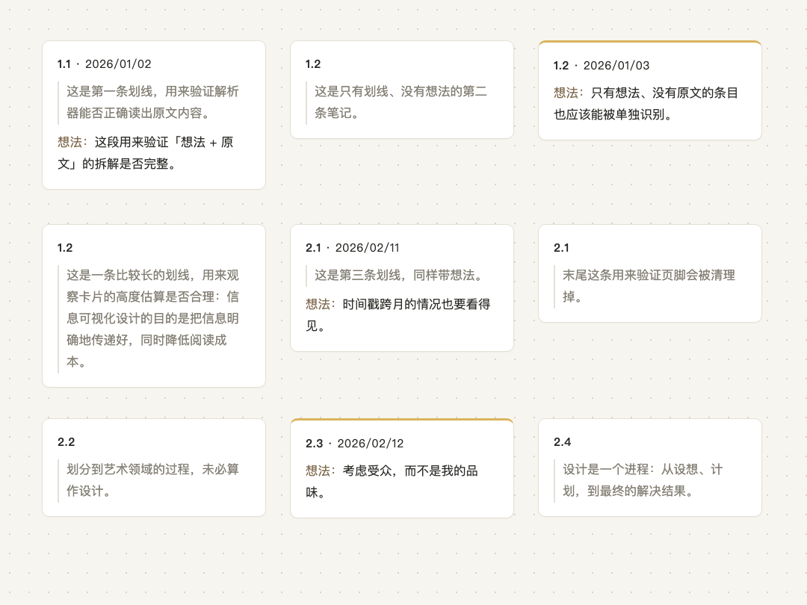

<p align="center"></p>

# Pale View（淡景）· 把笔记摊成画布（Obsidian 插件）

把笔记素材摊成一张 Obsidian Canvas：每条笔记一张卡片，保留**原文、想法、章节号、时间**，不带章节名称。

任何「外部产生、需要重新组织」的笔记——书里的划线、访谈的转写、课程的记录——都走同一条路：读入 → 拆卡 → 摊开。微信读书是第一个来源，不是唯一的来源。

| 来源 | 命令 | 状态 |
| --- | --- | --- |
| 微信读书 | `WeRead: new canvas from clipboard` / `... from pasted text` | 已支持 |
| Manet 转写 | `Manet: new canvas from clipboard` | 后续支持 |

> Pale View（中文名**淡景**）是一个 Obsidian 插件。名字来自一个画面：远处的山，轮廓是有的，雾把细节抹掉了一些。

## 它解决什么

读一本书会留下几十上百条划线和批注，一次访谈会留下几十分钟的转写，但要把它们变成能用的东西，就得重新组织一遍：回看原文、分类、排序、合并——四件事挤在同一步里，通常的结果是干脆不整理。

Pale View 只做整理之前的那一步：**把素材零决策地摊开**。导入时不需要做任何判断，打开画布就已经是一个可以开始摆放的全局视图。

## 安装

插件尚未上架社区市场，手动安装：

1. 下载本仓库的 `main.js`、`manifest.json`、`styles.css`。
2. 放进仓库目录 `.obsidian/plugins/pale-view/`（`pale-view` 文件夹名不要改）。
3. Obsidian → 设置 → 第三方插件 → 关闭安全模式 → 启用 **Pale View**。

macOS / Linux 也可以用脚本装到指定仓库：

```bash
./install.sh "/path/to/YourVault"
```

## 用法

1. 微信读书里选中笔记 →「一键复制」。
2. Obsidian 里 `Cmd+P` → 运行 **WeRead: new canvas from clipboard**。
   （剪贴板读不到时会自动弹出粘贴框，也可以用 **WeRead: new canvas from pasted text** 手动贴。）
3. 画布自动生成并打开。

生成的文件名是 `书名 阅读笔记.canvas`，默认放在当前笔记所在文件夹（可在设置里固定到一个文件夹）。



## 卡片长这样

```
**1.2** · 2026/01/02

> 这是第一条划线，用来验证解析器能否正确读出原文内容。

想法：这段用来验证「想法 + 原文」的拆解是否完整。
```

- 只有划线、没有想法的笔记，就只有章节号和引用块，没有时间（原文里也没有时间）。
- 只有想法的笔记，只有章节号、时间和想法。
- 带想法的卡片默认上黄色底（可在设置里换色或关闭）。

## 设置

| 项 | 说明 | 默认 |
| --- | --- | --- |
| 每行卡片数 | 横排列列数 | 3 |
| 卡片宽度 | 像素 | 340 |
| 给带想法的卡片上色 | 有想法的卡片加底色 | 开 |
| 想法卡片颜色 | 6 色可选 | 黄 |
| 保存文件夹 | 相对仓库根目录，留空=当前笔记所在文件夹 | 空 |

## 格式兼容（微信读书）

解析的是微信读书复制出来的这套结构：

```
《书名》

作者
42个笔记

1.1 导语

◆ 2026/10/23发表想法

想法文字

原文：划线原文
```

- 书名 `《…》` 只用于生成文件名，章节名丢弃，只留编号。
- 兼容全角冒号 `原文：` / 半角 `原文:`、`◆` `•` `▪` 三种项目符号、`2026/10/23` `2026-10-23` 两种日期。
- 末尾的 `-- 来自微信读书` 会被清掉。

## 目录

```
main.js          插件代码
manifest.json    插件清单
styles.css       弹窗样式
install.sh       安装脚本
assets/          图标与横幅
```

## License

[MIT](LICENSE) © 2026 任顾远
